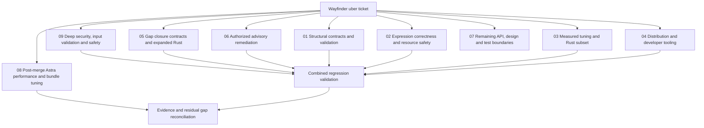

# Wayfinder: rules-machine overhaul

Update, 2026-10-14: the user authorized integration; the umbrella branch was fast-forwarded and pushed to `main` at `4f06377`. The original delivery below is historical. Post-merge Astra tuning is tracked in [ticket 08](tickets/08-astra-performance-bundle.md) and its [separate evidence](../../performance/wayfinder-followup/RESULTS.md).

The subsequent deep security review starts from merged main `ef4f3c5` and is tracked in [ticket 09](tickets/09-deep-security.md), with [its own plan](../security-review/PLAN.md). Fixes remain on `security/deep-review-2026-10-14`; branch pushes are authorized, while issues and PR drafts stay local. This follow-up is not automatically merged.

Started 2026-10-13. Original revision: `ee300adbf33a5a8b4d75c0b6eafd5198c1b5d230`.
Execution budget: up to four hours, at most four agents including reporting.
Tickets and PR drafts stay local in git. The user subsequently authorized pushing branches; six task branches have been pushed to origin, including the final reconciliation on the umbrella branch. Issues, PRs, merges and releases remain unpublished.

| Ticket | Owner | Acceptance | State |
| --- | --- | --- | --- |
| [01 Structural contracts](tickets/01-structural.md) | Architect | Nested returns/logical groups, array scope, validation, safe traces; regressions | Implemented and locally verified |
| [02 Expression safety](tickets/02-expression.md) | Coordinator | Correct assignment scanning, math domains, safe dictionaries and predicates; regressions | Implemented and locally verified |
| [03 Performance and Rust](tickets/03-performance-rust.md) | Performance Wizard | Frozen workload/oracles, original/tuned/Rust timings, explicit subset gaps | Implemented and locally verified |
| [04 Distribution](tickets/04-distribution.md) | Coordinator | Install/build/typecheck/lint/test and actual ESM/CJS/browser artifact checks | Implemented and locally verified |
| [05 Remaining contracts](tickets/05-residual-contracts.md) | Coordinator, Architect, Performance | Host/date/resource/cache/trace/type contracts; Rust core/bridge and end-to-end measurements | Implemented and locally verified |
| [08 Astra performance/bundle follow-up](tickets/08-astra-performance-bundle.md) | Coordinator, Astra | Four measured mechanisms, source/bundle/runtime correctness gates and retained evidence | Complete; browser bundle wins, runtime-only candidates rejected |
| [09 Deep security](tickets/09-deep-security.md) | Coordinator, runtime reviewer, Astra | Bounded reproductions, defensive fixes, source/package/browser/Rust qualification and residual boundaries | Complete;12 finding families fixed and locally qualified on security branch |
| [07 API/design/test boundaries](tickets/07-api-design-test-boundaries.md) | Coordinator | Close concrete interface defect; record unresolved contracts and missing deployment evidence | Interface fix verified; design follow-ups explicit |
| [06 Dependency advisories](tickets/06-dependency-advisories.md) | Coordinator |16 findings patched,0 known findings on re-audit; regression and performance confirmation | Implemented and locally verified |

## Authorized advisory follow-up

The user subsequently authorized the public advisory scan. It found 16 advisories; commit `ad5c47a` updates the affected packages and adds an actual-rule OMIT regression. The follow-up scan reported zero known advisories and 368 tests passed at that stage. The final October 14 scan still reports zero known findings across 150 dependencies; the expanded suite now has 462 tests. See [ticket 06](tickets/06-dependency-advisories.md) and [local dependency-security PR draft](prs/05-dependency-security.md). Final dependency-tree performance reconfirmation passed all 12 blocks; [new report](../../performance/comparison/results/2026-10-14-security/report.md) is separate from the original results.

## Final reconciliation

See [results and decisions](RESULTS.md), [compatibility notes](CHANGELOG.md), and [gap disposition](tickets/05-residual-contracts.md). The original overhaul and security confirmation remain retained as historical campaigns. The user's “Fill in those gaps” follow-up adds explicit host/date/resource/cache/trace/atomic/type contracts and expanded Rust core/bridge experiments. Final TypeScript runtime is `d4a88ea`; Rust is `91ef65e`, with parent envelope validation at `d532ef5`. Two additional Rust tuning loops passed independent review and paired confirmation. Final native, bridge and 12-pair crossover confirmation is complete; see results for exact source hashes and limits. The two-loop Rust gain is 1.640×; the bridge crosses over between 16 and 64 sequential increment rules in the controlled sweep, while large payloads reverse the advantage.

Local PR drafts: [runtime](prs/01-runtime-hardening.md), [distribution](prs/02-distribution.md), [performance/Rust](prs/03-performance-rust.md), [documentation](prs/04-specification-docs.md), [dependencies](prs/05-dependency-security.md), [gap contracts](prs/06-gap-contracts.md). No external PRs were created or linked.

## Baseline evidence

- Original suite: 267 tests pass in 8 files (Vitest 3.2.4, Node 26.8.2).
- Original typecheck fails: examples import undeclared `aws-lambda` types.
- Original build succeeds but emits `dist/index.js`; package exports reference absent `dist/index.mjs`.
- Original lint: 92 warnings, no errors.
- Executable reproductions: nested return yields 2 instead of 1; `"hello = world"` mutates an invalid key; `x=1` does not mutate; `COSH(1)` computes cosine; strict lookup rejects explicit null.
- Independent proposals: [Architect](council-architect.md), [Performance Wizard](council-performance.md). These preserve initial hypotheses separately from verified final conclusions.

## Tracking policy

No Wayfinder-specific tool/CLI was found. A GitHub uber-issue attempt was rejected by automatic approval review; the user then explicitly chose local tickets and PR drafts. No external issue or PR was created. The later instruction “push branches and stuff, just hold off on the issues/PRs” authorizes branch pushes to the configured origin. Git commits and these local records are the authoritative tracking mechanism for this run.

## Branch delivery

The integrated result is `overhaul/wayfinder-2026-10`. Supporting branches are `overhaul/performance-rust`, `overhaul/structural-hardening`, `gaps/value-date-contracts`, `gaps/rust-compatibility` and `gaps/wire-bounds`. The umbrella branch includes subsequent integration fixes and final tuning/evidence that are newer than the supporting branches. All six are pushed to the configured `elite-libs/rules-machine` origin; no force push, issue, PR, merge or release is part of delivery.
