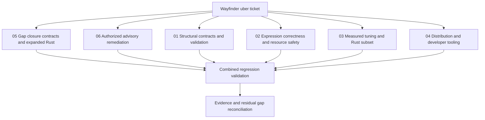

# Wayfinder: rules-machine overhaul

Started 2026-10-13. Original revision: `ee300adbf33a5a8b4d75c0b6eafd5198c1b5d230`.
Execution budget: up to four hours, at most four agents including reporting.
All tickets and PR drafts stay local in git, per the user's explicit choice.

| Ticket | Owner | Acceptance | State |
| --- | --- | --- | --- |
| [01 Structural contracts](tickets/01-structural.md) | Architect | Nested returns/logical groups, array scope, validation, safe traces; regressions | Implemented and locally verified |
| [02 Expression safety](tickets/02-expression.md) | Coordinator | Correct assignment scanning, math domains, safe dictionaries and predicates; regressions | Implemented and locally verified |
| [03 Performance and Rust](tickets/03-performance-rust.md) | Performance Wizard | Frozen workload/oracles, original/tuned/Rust timings, explicit subset gaps | Implemented and locally verified |
| [04 Distribution](tickets/04-distribution.md) | Coordinator | Install/build/typecheck/lint/test and actual ESM/CJS/browser artifact checks | Implemented and locally verified |
| [05 Remaining contracts](tickets/05-residual-contracts.md) | Coordinator, Architect, Performance | Host/date/resource/cache/trace/type contracts; Rust core/bridge and end-to-end measurements | Implemented; final confirmation in progress |
| [06 Dependency advisories](tickets/06-dependency-advisories.md) | Coordinator |16 findings patched,0 known findings on re-audit; regression and performance confirmation | Implemented and locally verified |

## Authorized advisory follow-up

The user subsequently authorized the public advisory scan. It found16 advisories; commit`ad5c47a` updates the affected packages and adds an actual-rule OMIT regression. A second scan reports zero known advisories and368 tests pass. See [ticket06](tickets/06-dependency-advisories.md) and [local dependency-security PR draft](prs/05-dependency-security.md). Final dependency-tree performance reconfirmation passed all12 blocks; [new report](../../performance/comparison/results/2026-10-14-security/report.md) is separate from the original results.

## Final reconciliation

See [results and decisions](RESULTS.md), [compatibility notes](CHANGELOG.md), and [gap disposition](tickets/05-residual-contracts.md). The original overhaul and security confirmation remain retained as historical campaigns. The user's “Fill in those gaps” follow-up adds explicit host/date/resource/cache/trace/atomic/type contracts and expanded Rust core/bridge experiments. TypeScript source is frozen at `02d9c60`; final confirmation is in progress.

Local PR drafts: [runtime](prs/01-runtime-hardening.md), [distribution](prs/02-distribution.md), [performance/Rust](prs/03-performance-rust.md), [documentation](prs/04-specification-docs.md), [dependencies](prs/05-dependency-security.md), [gap contracts](prs/06-gap-contracts.md). No external PRs were created or linked.

## Baseline evidence

- Original suite: 267 tests pass in 8 files (Vitest 3.2.4, Node 26.8.2).
- Original typecheck fails: examples import undeclared `aws-lambda` types.
- Original build succeeds but emits `dist/index.js`; package exports reference absent `dist/index.mjs`.
- Original lint: 92 warnings, no errors.
- Executable reproductions: nested return yields 2 instead of 1; `"hello = world"` mutates an invalid key; `x=1` does not mutate; `COSH(1)` computes cosine; strict lookup rejects explicit null.
- Independent proposals: [Architect](council-architect.md), [Performance Wizard](council-performance.md). These preserve initial hypotheses separately from verified final conclusions.

## Tracking policy

No Wayfinder-specific tool/CLI was found. A GitHub uber-issue attempt was rejected by automatic approval review; the user then explicitly chose local tickets and PR drafts. No external issue or PR was created. Git commits and these local records are the authoritative tracking mechanism for this run.
