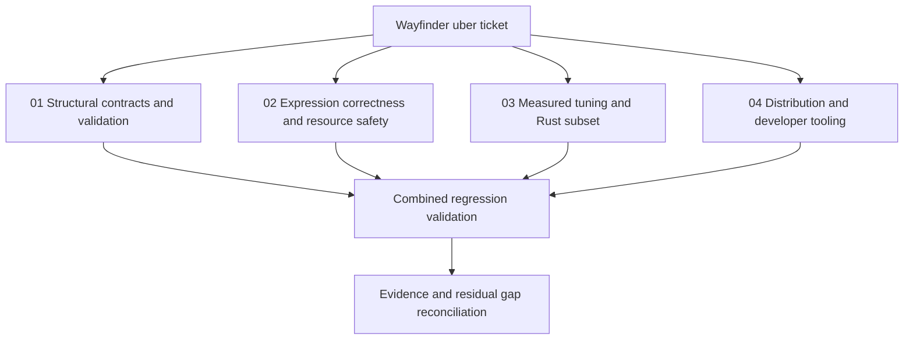

# Wayfinder: rules-machine overhaul

Started 2026-10-13. Original revision: `ee300adbf33a5a8b4d75c0b6eafd5198c1b5d230`.
Execution budget: up to four hours, at most four agents including reporting.
All tickets and PR drafts stay local in git, per the user's explicit choice.

| Ticket | Owner | Acceptance | State |
| --- | --- | --- | --- |
| [01 Structural contracts](tickets/01-structural.md) | Architect | Nested returns/logical groups, array scope, validation, safe traces; regressions | In progress |
| [02 Expression safety](tickets/02-expression.md) | Coordinator | Correct assignment scanning, math domains, safe dictionaries and predicates; regressions | In progress |
| [03 Performance and Rust](tickets/03-performance-rust.md) | Performance Wizard | Frozen workload/oracles, original/tuned/Rust timings, explicit subset gaps | In progress |
| [04 Distribution](tickets/04-distribution.md) | Coordinator | Install/build/typecheck/lint/test and actual ESM/CJS/browser artifact checks | In progress |

## Baseline evidence

- Original suite: 267 tests pass in 8 files (Vitest 3.2.4, Node 26.8.2).
- Original typecheck fails: examples import undeclared `aws-lambda` types.
- Original build succeeds but emits `dist/index.js`; package exports reference absent `dist/index.mjs`.
- Original lint: 92 warnings, no errors.
- Executable reproductions: nested return yields 2 instead of 1; `"hello = world"` mutates an invalid key; `x=1` does not mutate; `COSH(1)` computes cosine; strict lookup rejects explicit null.
- Independent proposals: [Architect](council-architect.md), [Performance Wizard](council-performance.md). These preserve initial hypotheses separately from verified final conclusions.

## Tracking policy

No Wayfinder-specific tool/CLI was found. A GitHub uber-issue attempt was rejected by automatic approval review; the user then explicitly chose local tickets and PR drafts. No external issue or PR was created. Git commits and these local records are the authoritative tracking mechanism for this run.
